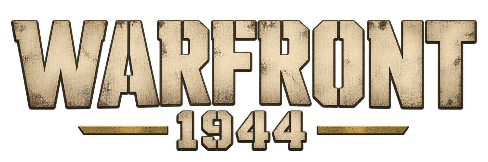

<h1 align="center"></h1>

## Plane-drop fork

This fork adds a plane insertion to the start of solo matches. Press **Space** to jump, then press it again to open your parachute;
use the movement controls to steer. The plane ejects you automatically at the end of its route, and the parachute opens automatically
near the ground. Bots, combat, and the match clock start the moment you land. Normal first-person combat, respawns,
maps, and multiplayer use the original rules. The class menus are removed and every player uses the Assault loadout. Pause also pauses
the insertion.

Build with `python3 build.py`, then serve `dist/` with `python3 -m http.server 8765 --directory dist` and open
`http://localhost:8765/riposte-frontline.html`. This is an independent fork and is not an official Riposte release.
The upstream license and asset notices below still apply. For development tests that need an immediate ground start, set
`window.MATCH_PLANE_DROP = false` before starting a match, or call `startMatch({ planeDrop: false })`.

**WARFRONT 1944** is a World War II-themed browser shooter built from the open-source Riposte: Frontline codebase. The fork keeps
the original combat and maps, removes class selection, and begins solo matches with an airborne insertion.

This repository is a snapshot of the game's source code, version 5.6.0. It is updated from time to time, not with every
release of the game. You can read it,
download it and use it for your own games under the MIT License (`LICENSE`), except for the items listed in `NOTICE.md` (name and
logo, music, soldier animations, some sounds). Development happens elsewhere, so pull requests are not merged. To report a problem,
use the Community space in the game.

## What is inside

The whole game: renderer (three.js), maps, scenery, weapons, soldiers and outfits, bots, physics, sound, menus, keyboard, mouse,
gamepad and touch controls, browser to browser multiplayer. All geometry is built by code, with no imported 3D model.

The server side of the official site is not included: accounts, saved progress, leaderboard, friends, community, moderation and the
game server for online lobbies. Without it, the game runs solo and online matches go from browser to browser (PeerJS). The account
screens say that accounts are not available.

## Build and play

Nothing to install, Python 3 is enough:

```bash
python3 build.py
```

The script assembles `dist/riposte-frontline.html`, the game page, along with `dist/tex/` and `dist/sfx/` (textures and sounds,
loaded when a map starts). Open `dist/riposte-frontline.html` in a recent browser (Chrome, Edge, Firefox) with those folders next to
it. The `dist/` folder of this repository is already built.

## How the code is organized

The game is written in French: code, comments and tool output. `src/*.js` is joined in alphabetical order, then injected into
`shell.html` (page, styles and menus). Each function is declared only once (`python3 tools/dev/check_decl.py`).

| Files | Content |
| --- | --- |
| `src/00-*`, `src/01-*` | translations, startup, rendering and GPU settings |
| `src/02-*` | maps and scenery: terrain, materials, lighting, water, vegetation, each map's kit |
| `src/03-*`, `src/07-*` | bot navigation and AI |
| `src/04-*` | effects, object physics |
| `src/05-*` | sound |
| `src/06-*` | weapons and their models, soldiers, animations, outfits, ragdolls |
| `src/08-*` | player, controls, killstreaks, vehicles |
| `src/09-*` | match, loading, network, menus, touch and gamepad controls, interface |
| `i18n/en.txt` | English texts (the game is written in French, English is the default language) |
| `assets/` | textures, sounds, baked animations, icons |
| `tools/` | asset building (`build_*.py`), checks and visual tests (`tools/dev/`) |

The visual tests in `tools/dev/visual/` open the game in Chromium (`cd tools/dev && npm ci`, then for example
`node tools/dev/visual/menus.js`).
